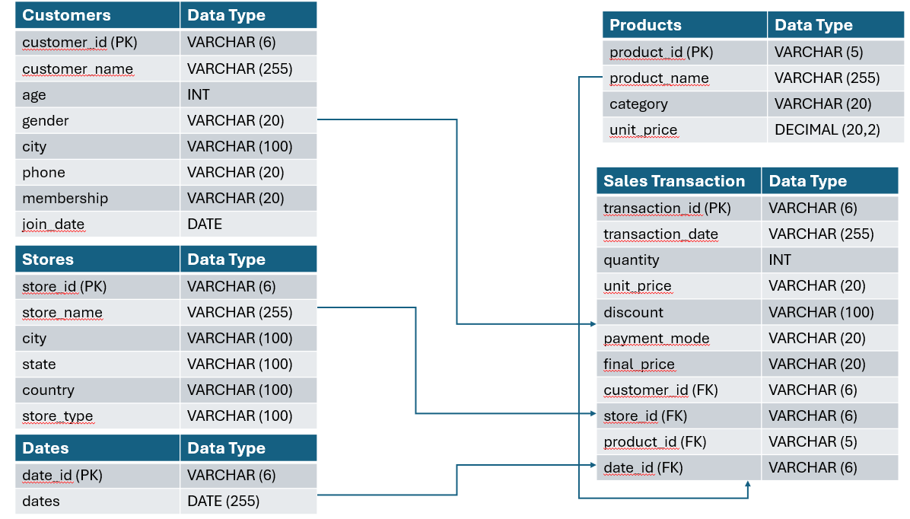

# Dataset Design

## 1. Dataset Overview
ABC is a fictional retail company operating at seven different stores in India 
| Table Info | Details |
|---------------------|---------|
| Domain | Retail Analytics |
| Dataset Type | Transactional |
| Time Period | 2021-2025 |
| Database | PostgreSQL |
| Number of Tables | 5 |

## 2. Why Synthetic Dataset
- No access to confidential enterprise retail data
- Synthetic data mimics realistic business scenarios
- Allows demonstration of end-to-end analytics without privacy concerns

## 3. Database Statistics & Table Descriptions
| Metric |Value | Purpose |
|---------------------|---------|---------|
| Customers | 10000 | Store customer Demographics |
| Stores | 7 | Stores related data
| Products | 900 | Stores product master info
| Dates | -- | Calendar Dimension
| Transactions | 700000 | Stores sales transaction records

## 4. Data Model (ERD)

## 5. Data Generation Logic
- Customer names generated using Faker (en_IN)
- Product catalog manually designed
- Transactions generated using business rules
- Random seed used for reproducibility
- Date range fixed between 2021 and 2025

## 6. Data Quality Considerations
- No missing values by design
- No duplicate primary keys
- Referential integrity maintained
- Data types validated during import
- Consistent category values

## 7. Dataset Granularity

- Customer Table: One row per customer
- Product Table: One row per product
- Store Table: One row per store
- Date Table: One row per calendar date
- Sales Transaction Table: One row per purchased product in a transaction
