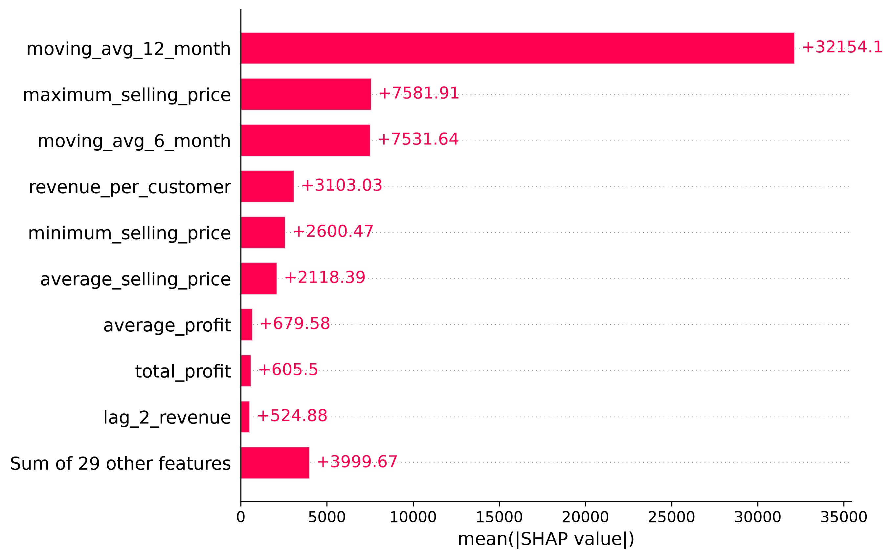
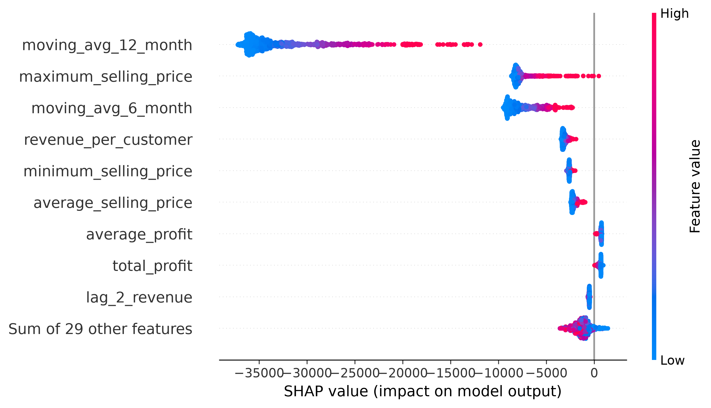
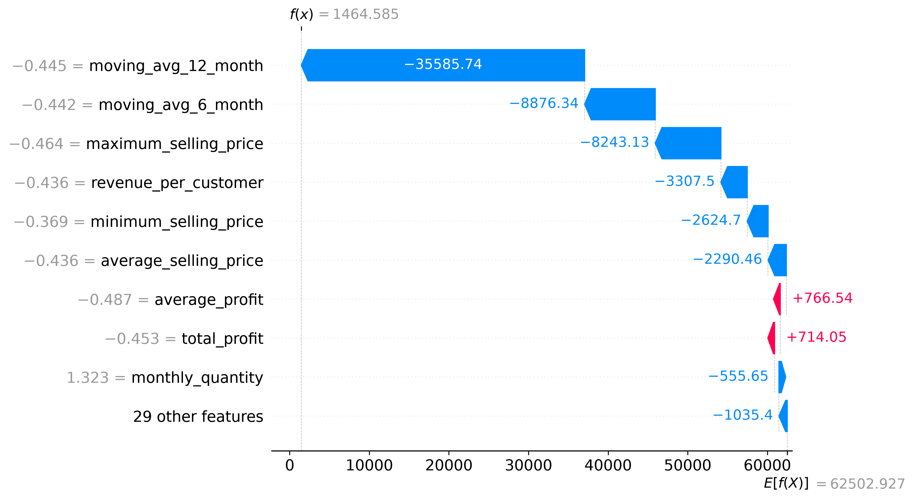
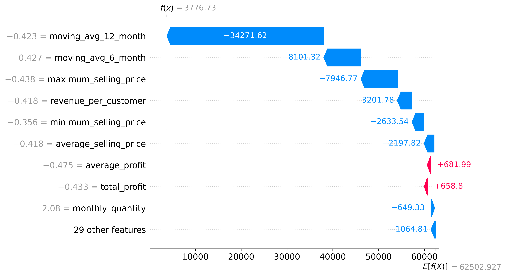
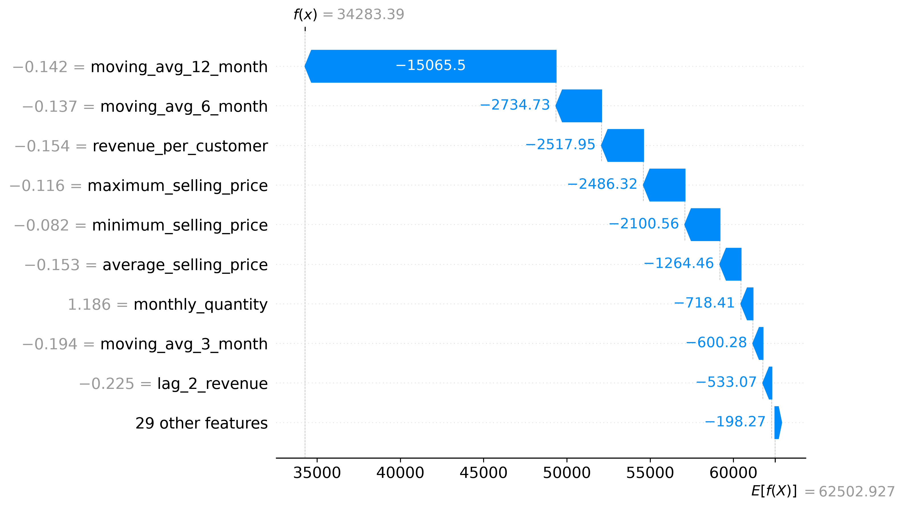

# SHAP Setup & Methodology
SHAP (SHapley Additive exPlanations) was used to interpret the predictions of the final Random Forest regression model.

The analysis was performed using TreeExplainer, which is designed for tree-based models such as Random Forest. SHAP values were generated for a sample of 1,000 observations from the validation dataset.

The final model used 38 selected features after feature selection.

SHAP was used at three levels:

Global Feature Importance — to identify which features have the greatest overall influence on model predictions.

Beeswarm Analysis — to understand both the magnitude and direction of feature effects across observations.

Individual Prediction Analysis — using waterfall plots to explain how individual feature values move a prediction away from the model's baseline.

The SHAP baseline represents the average model output for the observations used in the SHAP explanation. Individual predictions are obtained by adding the SHAP contributions of the features to this baseline.

# Global Feature Importance
The global SHAP analysis identifies the features that contribute most strongly to the model's predictions.

The most influential features include:

+ moving_avg_12_month

+ revenue_per_customer

+ maximum_selling_price

+ moving_avg_6_month

+ average_selling_price

+ minimum_selling_price

moving_avg_12_month has the largest overall SHAP importance, indicating that the model relies heavily on longer-term historical revenue patterns when predicting next-month revenue.

# Beeswarm Interpretation
The SHAP beeswarm plot provides information about both the magnitude and direction of feature contributions across the analyzed observations.

The distribution confirms that the moving-average features, particularly moving_avg_12_month and moving_avg_6_month, have a substantial influence on predictions.

# Individual Predictions
## Observation - 71
The baseline is approximately 62,502.93, while the model's prediction is approximately 1464.585. The features shown explain how the prediction moves from the baseline to that final value.

### Main downward contributors
| Feature | SHAP Contribution |
|---------------------|---------|
| moving_avg_12_month | -35585.744710 |
| moving_avg_6_month  | -8876.335110 |
| maximum_selling_price | -8243.129604 |
| revenue_per_customer | -3307.503798 |
| minimum_selling_price | -2624.698385 |

These features pushed the prediction downward relative to the baseline.

### Main upward contributors
|Feature | SHAP contribution |
|---------------------|---------|
| average_profit | +766.536090 |
| total_profit | +714.051635 |
          
These features pushed the prediction upward, partially offsetting the negative contributions.

## Observation - 136

The baseline is approximately 62,502.93, while the model's prediction is approximately 3,766.63. The features shown explain how the prediction moves from the baseline to that final value.

### Main downward contributors
| Feature | SHAP Contribution |
|---------------------|---------|
| moving_avg_12_month | -34,271.62 |
| moving_avg_6_month | -8,101.32 |
| maximum_selling_price | −7,946.77 |
| revenue_per_customer | −3,201.78 |
| minimum_selling_price | −2,633.54 |
| average_selling_price | −2,197.82 |

These features pushed the prediction downward relative to the baseline.

### Main upward contributors
|Feature | SHAP contribution |
|---------------------|---------|
| average_profit | +681.99 |
| total_profit | +658.80 |

These features pushed the prediction upward, partially offsetting the negative contributions.

The baseline is approximately 62,502.93, while the model's prediction is approximately 34,283.39. The features shown explain how the prediction moves from the baseline to that final value.

## Observation - 176

### Main downward contributors
| Feature | SHAP Contribution |
|---------------------|---------|
| moving_avg_12_month  | -15065.495067 |
| moving_avg_6_month   | -2734.725151 |
| revenue_per_customer | -2517.950275 |
| maximum_selling_price | -2486.323308 |
| minimum_selling_price | -2100.561300 |

These features pushed the prediction downward relative to the baseline.

### Main upward contributors
|Feature | SHAP contribution |
|---------------------|---------|
| average_profit | +496.890212
| total_profit | +266.933246 |

These features pushed the prediction upward, partially offsetting the negative contributions.

### Business interpretation
For this product-month observation, the moving-average features account for the largest downward contributions. Profit-related features push the prediction upward, but their positive contributions are much smaller than the largest negative effects.

# Top 20 Error Analysis

## Top 20 Observations by Absolute Error

The following observations are the **20 validation observations with the highest absolute prediction errors** from the 2024 validation dataset.

| Product ID | Product Name | Actual | Predicted | Monthly Revenue | Moving Avg 12 | Absolute Error | Signed Error | Percentage Error | Signed Percentage Error | Month |
|---|---|---:|---:|---:|---:|---:|---:|---:|---:|---:|
| P1603 | Laptop Premium 256GB | 2,429,583.75 | 1,003,894.51 | 1,198,642.50 | 965,772.50 | 1,425,689.24 | 1,425,689.24 | 58.68% | 58.68% | 1 |
| P1604 | Laptop Premium 512GB | 2,472,525.00 | 1,189,097.25 | 856,845.00 | 1,200,375.00 | 1,283,427.75 | 1,283,427.75 | 51.91% | 51.91% | 7 |
| P1600 | Laptop Standard 512GB | 2,193,048.00 | 980,569.42 | 105,732.00 | 970,794.00 | 1,212,478.58 | 1,212,478.58 | 55.29% | 55.29% | 9 |
| P1604 | Laptop Premium 512GB | 2,050,785.00 | 958,538.06 | 1,782,000.00 | 1,334,767.50 | 1,092,246.94 | 1,092,246.94 | 53.26% | 53.26% | 10 |
| P1599 | Laptop Standard 256GB | 1,621,158.00 | 683,637.18 | 964,656.00 | 867,999.00 | 937,520.82 | 937,520.82 | 57.83% | 57.83% | 7 |
| P1600 | Laptop Standard 512GB | 432,432.00 | 1,275,353.18 | 749,628.00 | 1,004,256.00 | 842,921.18 | -842,921.18 | 194.93% | -194.93% | 11 |
| P1600 | Laptop Standard 512GB | 105,732.00 | 936,961.82 | 1,533,708.00 | 1,033,560.00 | 831,229.82 | -831,229.82 | 786.17% | -786.17% | 8 |
| P1712 | Air Conditioner Premium 512GB | 1,821,204.00 | 1,049,362.12 | 1,050,084.00 | 1,158,475.50 | 771,841.88 | 771,841.88 | 42.38% | 42.38% | 7 |
| P1664 | Television Premium 512GB | 1,542,240.00 | 778,447.98 | 950,670.00 | 834,592.50 | 763,792.02 | 763,792.02 | 49.52% | 49.52% | 10 |
| P1711 | Air Conditioner Premium 256GB | 1,552,036.50 | 805,277.84 | 86,782.50 | 667,007.25 | 746,758.66 | 746,758.66 | 48.11% | 48.11% | 9 |
| P1711 | Air Conditioner Premium 256GB | 86,782.50 | 827,489.02 | 339,822.00 | 730,191.00 | 740,706.52 | -740,706.52 | 853.52% | -853.52% | 8 |
| P1712 | Air Conditioner Premium 512GB | 325,458.00 | 1,062,421.76 | 1,292,760.00 | 1,218,483.00 | 736,963.76 | -736,963.76 | 226.44% | -226.44% | 10 |
| P1710 | Air Conditioner Premium 128GB | 1,438,668.00 | 723,590.29 | 616,140.00 | 642,033.00 | 715,077.71 | 715,077.71 | 49.70% | 49.70% | 4 |
| P1599 | Laptop Standard 256GB | 1,468,038.00 | 753,745.96 | 720,621.00 | 961,067.25 | 714,292.04 | 714,292.04 | 48.66% | 48.66% | 9 |
| P1602 | Laptop Premium 128GB | 1,456,290.00 | 772,206.12 | 653,400.00 | 1,153,350.00 | 684,083.88 | 684,083.88 | 46.97% | 46.97% | 3 |
| P1675 | Refrigerator Premium 256GB | 1,212,997.50 | 534,037.83 | 592,470.00 | 560,334.38 | 678,959.67 | 678,959.67 | 55.97% | 55.97% | 8 |
| P1600 | Laptop Standard 512GB | 1,758,240.00 | 1,089,669.18 | 432,432.00 | 995,247.00 | 668,570.82 | 668,570.82 | 38.03% | 38.03% | 12 |
| P1712 | Air Conditioner Premium 512GB | 549,990.00 | 1,214,943.48 | 325,458.00 | 1,070,401.50 | 664,953.48 | -664,953.48 | 120.90% | -120.90% | 11 |
| P1611 | Tablet Standard 256GB | 1,077,930.00 | 413,830.43 | 416,295.00 | 382,800.00 | 664,099.57 | 664,099.57 | 61.61% | 61.61% | 5 |
| P1712 | Air Conditioner Premium 512GB | 521,640.00 | 1,183,132.34 | 1,233,792.00 | 1,107,823.50 | 661,492.34 | -661,492.34 | 126.81% | -126.81% | 4 |

### Observations:

- The largest errors include both substantial under-predictions and over-predictions.

- Several observations have actual revenue substantially different from both recent monthly_revenue and the longer-term moving_avg_12.

- P1600 and P1712 each appear four times among the top 20 absolute-error observations.

- July–October account for 9 of the 20 observations, indicating a concentration of large errors during these months.

- These observations represent extreme prediction errors and should not be interpreted as representative of overall model performance.

# Key Findings & Limitations

## Key Findings
+ Historical revenue patterns are the dominant drivers. moving_avg_12_month and moving_avg_6_month consistently appear among the strongest SHAP contributors.

+ Revenue and price characteristics also have substantial influence. Features such as revenue_per_customer, maximum_selling_price, average_selling_price, and minimum_selling_price contribute meaningfully to predictions.

+ Profit-related features generally provide smaller contributions in the analyzed individual predictions compared with the major moving-average features.

+ Individual predictions can differ substantially from the baseline, demonstrating that the model adjusts its prediction based on the feature values of each product-month observation.

+ Large prediction errors are concentrated in a relatively small number of observations, with several extreme errors occurring for high-revenue Electronics products.

+ The error analysis shows both under-prediction and over-prediction, indicating that the model does not exhibit only one type of prediction error.

## Limitations

+ SHAP explains the behavior of the trained model; it does not establish causal relationships between features and revenue.

+ The individual waterfall plots represent selected observations and therefore should not be interpreted as representative of every prediction.

+ The Top-20 error analysis focuses specifically on the observations with the largest absolute errors and therefore represents the model's most difficult cases rather than its overall performance.

+ SHAP analysis explains why the model made a prediction, but it does not by itself explain why the actual business outcome occurred.